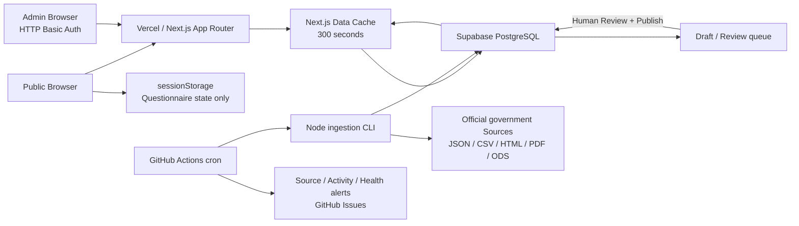
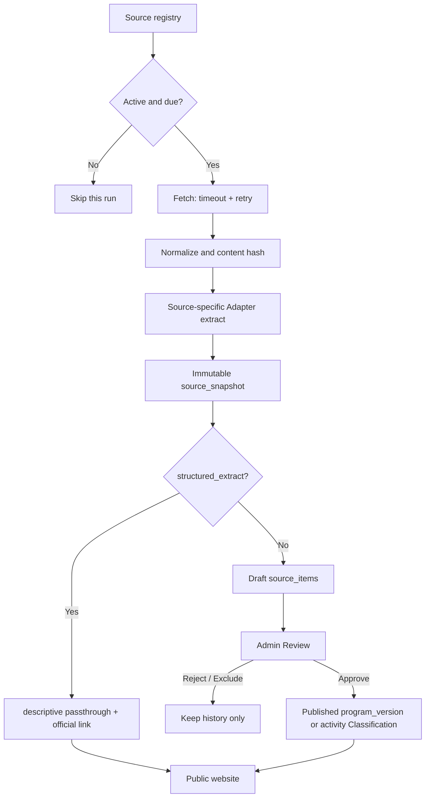

# Gov Welfare Architecture 與 Production Gap

> 最後核對：2026-08-12（Asia/Taipei）
> 本文件描述 Repository 與 Production **實際已實作**的狀態，不是最初 PRD 或未完成的 Roadmap。

## 結論

目前是一個可運作的 Source-first MVP：Next.js 部署在 Vercel、Supabase PostgreSQL 保存官方 Source 歷史與人工 Review 結果、GitHub Actions cron 定期抓取官方資料。Public questionnaire 不會把個人回答送到 Server 或 Database。

系統有 cron job，但它是 **GitHub Actions Scheduled workflow**，不是 Vercel Cron。它每天被排程喚醒，只檢查到期的 Sources 並保存 immutable Snapshot。Structured government API row 會更新為 descriptive passthrough；Program Rules 不會自動 Publish，Authority page／PDF 的變更仍需人工 Review。

Production 現在可用，但還不是「全臺完整福利平台」。Catalog 已另外支援企業申請對象與第一批企業升級方案；這些企業方案只做 `descriptive_only` 官方導流，不參與自然人資格 Matching。接下來最重要的是改善 Admin identity／Audit attribution，以及建立 Backup／restore 與 monitoring 的正式作業方式。

## Operational snapshot

以下數字是 2026-08-07 Repository-reviewed data 發布後的基準，會隨 Source check 與人工 Review 改變：

| 項目 | Production 狀態 |
| --- | ---: |
| Public Programs | 88 |
| `matchable` | 58 |
| `descriptive_only` | 30 |
| `needs_review` | 0 |
| 中央／地方分布 | 中央 38、桃園 22、新北 8、臺北 10、臺中 10 |
| Source registry | 78 |
| Active Sources | 72 |
| Blocked Sources | 5 |
| Active Source fetch failure | 0 |
| Public activities | 6 |
| Public health | `healthy` |

Production URL：<https://gov-welfare-iota.vercel.app>

## System architecture



### Runtime components

| Layer | 目前實作 | Rationale |
| --- | --- | --- |
| Web | Next.js 16 App Router、React 19、TypeScript | Public UI、Server rendering、API、Admin 都留在同一 Repository，避免 Microservices overhead。 |
| Hosting | Vercel Production | 負責 Next.js build、Server Functions、Static assets 與 deployment。 |
| Database | Supabase PostgreSQL + PostgREST | 保存 Source registry、Snapshot、Draft、Published Program version、Evidence 與 Review history。 |
| Ingestion | 同 Repository 的 Node CLI | Scheduled workflow 可在 Web request timeout 之外抓取與解析官方資料。 |
| Scheduler | GitHub Actions Scheduled workflow | 每日喚醒後依 Source frequency 檢查；沒有 Vercel Cron。 |
| Search | PostgreSQL index + 目前 Catalog 的 in-memory filtering | MVP 資料量只有數十筆，暫不需要 Elasticsearch。 |
| Public profile | Browser `sessionStorage` | 不建立帳號、不保存個人答案，降低 Privacy 與 Security 風險。 |

目前沒有 Redis、Queue、Elasticsearch、Vector database、LLM Runtime、獨立 CMS 或 Microservices。

## Public request 與 rendering flow

### Routes

| Route | Rendering | 說明 |
| --- | --- | --- |
| `/` | Static，5 分鐘 revalidate | 首頁與精選 Programs／activities。 |
| `/find` | Static，5 分鐘 revalidate + Client matching | Server 只提供 Programs；回答與 Rule evaluation 在 Browser 執行。 |
| `/programs` | Dynamic SSR | Query string 負責關鍵字、申請對象、Category、縣市、Benefit、狀態、排序、分頁與 view mode。 |
| `/programs/[slug]` | SSG，5 分鐘 revalidate | Program detail、Rule tree、Evidence 與官方入口。 |
| `/activities` | Dynamic SSR | 活動地點、對象、類型、報名狀態與關鍵字篩選。 |
| `/activities/[slug]` | SSG，5 分鐘 revalidate | 活動資格、日期、費用、Evidence 與官方入口。 |
| `/admin` | Dynamic SSR、private `no-store` | Authority-only `needs_review` Queue、Evidence refresh、Draft、Publish、Reject、Rollback；Source history 僅供進階診斷。 |
| `/api/programs` | Dynamic API | Public Program payload；HTTP response 不快取，但底層 Program store 快取 5 分鐘。 |
| `/api/opportunities` | Dynamic API | 平台維護的 Public activity payload；CDN cache 5 分鐘。 |
| `/api/activity-reports` | Dynamic POST API | 匿名活動錯誤回報；Server validation 後以 Service Role 寫入 Supabase。 |
| `/api/health` | Dynamic API、`no-store` | Database、Source failure 與 `needs_review` 摘要。 |

### Cache behavior

- `getPrograms()` 使用 `unstable_cache`，TTL 為 300 秒；`getOpportunities()` 讀取 Repository data，不查 Supabase。
- Program request 在同一個 5 分鐘 window 內不會每次都重新查 Supabase。
- Admin Publish／Rollback 後使用 `updateTag()` 立即 invalidation，不必等待 TTL。
- `programs` 與 `activities` Catalog 因為依賴 `searchParams`，仍是 Dynamic SSR；慢的主因通常是 Server round trip 與 page navigation，不是每次重新抓完整 Database。
- Detail page 使用 Browser history 返回，因此 URL query、分頁與 view mode 會恢復；`/find` 的 step 與 answers 另外保存在同一分頁的 `sessionStorage`。

### Failure behavior

- Supabase 讀取失敗時，Public Programs 回到 Repository reviewed Seed，不讓整站中斷。
- Source fetch 失敗時保留上一個 Published version，不刪除 Public data。
- Authority page／PDF 的最新 successful Snapshot 與 Published Evidence 之間，若會顯示給使用者的文字確實不同，Program Runtime state 才會降為 `needs_review`；點閱／下載次數與擷取 URL 不觸發 Review。
- Structured government API 的 Snapshot 更新不會觸發人工 Review；它只更新 descriptive data，公開內容附官方連結，也不會自動改寫資格 Rules。
- Activity 使用 Repository 內平台維護的 data 顯示，Crawler 只作 Discovery，不因 Snapshot 變動產生人工 Queue。每筆附官方連結與資料整理日期，使用者可匿名回報錯誤。

### `needs_review` Admin workflow

1. Admin 比較 Authority page／PDF 等非 `structured_extract` Source 的 Evidence Snapshot 與最新 successful Snapshot，並正規化點閱／下載次數、忽略擷取 URL。
2. 只有公開文字不同的 Program 進入「資格來源待複核」，顯示新舊內容與官方連結；Structured API 的一般 Dataset 更新不產生待辦。
3. Reviewer 可修正 locator／extracted value，填寫 Reviewer 與 Rationale，確認 Canonical content／Rules 未受影響後建立新 Draft。
4. Draft 會複製完整 Program version，只把已複核 Evidence 指向最新 Snapshot；建立動作記錄為 `resolve_conflict` Audit event。
5. Draft 仍須在「福利方案待審核」再次 Publish；PostgreSQL Publish gate 會重新驗證 Authority Evidence 與 Source state。Structured API Evidence 不參與 freshness gate。
6. 若資格 Rule、Benefit、金額或期限真的改變，不允許只更新 Evidence，必須先更新 Canonical content 再 Publish。
7. Publish 前的 Server Gate 使用相同可見文字 Diff；PostgreSQL RPC 保留 Evidence 完整、Reviewed 與 Source error Gate，但不再用 Snapshot ID 本身代表內容改變。

## Database 保存什麼

Database **不是拿來保存使用者性別、年齡或 Questionnaire answers**。它保存的是政府資料的版本、來源和人工決策：

| Table | 保存內容 |
| --- | --- |
| `sources` | Source registry、主管機關、Jurisdiction、URL、Adapter、frequency、最後檢查與錯誤狀態。 |
| `source_snapshots` | 每次成功或失敗的 fetch 紀錄、HTTP metadata、content hash 與 raw response。 |
| `source_items` | 從一個 JSON row、HTML page 或 document 擷取出的 Draft、unknown fields、Classification 與 Review state。 |
| `programs` | Program 的 stable identity、slug、主管機關、Jurisdiction 與 Primary category。 |
| `program_versions` | Versioned canonical content、Rule tree、Coverage、申請期間與 Publish state。 |
| `field_evidence` | 每個重要欄位及 Atomic rule 對應的 Source、Snapshot、locator、extracted value 與 Review 時間。 |
| `reviews` | Publish、Reject、Classification、Rollback 的 Reviewer、時間與 Rationale。 |
| `activity_reports` | 使用者回報的活動過期、官方連結失效、內容或資格錯誤，以及 Admin 處理狀態。 |
| `program_relationships` | 中央與地方版本、加碼、執行或取代關係的 Data structure；Schema 已具備。 |

`source_snapshots.storage_path` 已預留給 Supabase Storage，但目前 ingestion 實際把 raw payload 寫在 `raw_body`；PDF 會以 base64 保存。資料量繼續成長前需要制定 retention／Storage policy。

## Source ingestion pipeline



### Adapter boundary

- Structured adapters：桃園 JSON、新北／臺北 CSV、臺中 JSON、ODS。
- MyEGov HTML adapter：解析 service sections 並去除申辦方式的重複內容。
- Official page adapter：只擷取標題、日期、正文與 links，不自動建立正式 Rules。
- Document monitor：PDF／document 只做 format check、download 與 content hash；異動後進 Review。
- Unknown fields 會保留在 `unknown_fields`，不會因 canonical schema 不認得就丟失。
- 每個 fetch 最多嘗試 3 次，單次預設 timeout 20 秒。

### Publish safety gate

Program Publish 前，Server 與 PostgreSQL function 會再次檢查：

- Reviewer 與至少 10 字的 Rationale。
- 官方 application URL 與 `last_verified_at`。
- Required Evidence 是否存在且已 Review。
- Authority Evidence 是否指向該 Source 最新 successful Snapshot；`structured_extract` Source 不參與這個 freshness gate。
- Authority Source 最近一次 check 是否成功；Structured API fetch failure 不會撤下上一個可用內容。
- 同一 Program 同時間只能有一個 Published version；舊版轉為 `superseded`，可做 Rollback。

HTML 或 PDF 的自動擷取結果不能直接越過這個 gate；Structured Open Data 只可作 descriptive passthrough，不能自動建立或修改 `matchable` Rules。

## Cron job

### 有，而且目前有正常執行

設定檔：`.github/workflows/source-check.yml`

| 項目 | 設定／行為 |
| --- | --- |
| Scheduler | GitHub Actions `schedule` |
| Cron expression | `17 1 * * *` |
| 名義時間 | 每天 01:17 UTC，即台灣時間 09:17 |
| 實際時間保證 | 無；GitHub Actions 可能延遲數分鐘到數小時 |
| Job timeout | 15 分鐘 |
| Concurrency | 同一時間只允許一個 `welfare-source-check`，不取消正在執行的 run |
| Runtime | Ubuntu + Node.js 22 + `npm ci` |
| Output | `source-report.json` artifact，保留 30 天 |
| Failure alert | 建立／更新 `Source monitoring failure` GitHub Issue；恢復後留言並關閉 |
| Auto Publish | 沒有 |

2026-08-01 最新 scheduled run 成功；實際開始時間為 04:37 UTC（台灣時間 12:37），可看出 schedule 不是精準 Scheduler。當時 Publish 與 data audit steps 都被正確 skip，因為 scheduled run 只負責 Draft ingestion。

### Source frequency

Workflow 雖然每天喚醒，但 CLI 會讀取 `last_checked_at` 與 `checkEveryHours`，只抓到期 Sources：

| Frequency | Sources |
| --- | ---: |
| 每 24 小時 | 13 |
| 每 168 小時 | 56 |
| 每 720 小時 | 3 |

若上次 check 失敗，下一次 workflow 會優先重試。手動 `workflow_dispatch` 預設加上 `--force`，檢查全部 active Sources；勾選 `retry_failed_only` 時不加 `--force`，只處理失敗或已到期 Sources。

只有手動執行 workflow 並勾選 `publish_reviewed_programs` 時，才會執行 Repository-reviewed Program import 與 `data:audit`。Activity data 由 Repository 直接提供，Crawler 結果不參與 Publish gate；使用者回報另在 Admin 處理。

另一個 `.github/workflows/activity-report-alert.yml` 每小時檢查一次 `activity_reports`：有未處理回報時建立或更新 `Activity reports need review` Issue，全部處理後自動關閉。Issue 只保存待處理數量與 Admin 連結，不複製使用者提交的內容。

`.github/workflows/production-health.yml` 每 30 分鐘檢查 Production `/api/health`。無法連線或狀態不是 `healthy` 時建立單一 `Production health failure` Issue；持續異常不重複建立 Issue，恢復後自動留言並關閉。是否收到 Email／GitHub App 通知取決於 Repository Watch 與個人 Notifications 設定。

### 其他 Scheduler 限制

- 沒有 Vercel Cron route 或 `vercel.json` cron 設定。
- 沒有 Queue；Source checks 目前逐筆 sequential 執行。

## Security 與 Privacy boundary

- `/admin` 由 `proxy.ts` 的 HTTP Basic Auth 保護；未設定 `ADMIN_PASSWORD` 時 fail closed，回應 503。
- Admin Server Actions 會重新驗證 Authorization header，不只依賴頁面入口。
- Supabase Service Role 只存在 Vercel／GitHub Secrets 與 Server-side code，不會送到 Client bundle。
- Supabase Tables 啟用 RLS；Public 只可讀 Published Program versions／Evidence 和必要的 Program identity。
- Public answers 只寫入同一 tab 的 `sessionStorage`，關閉 tab 後消失；沒有 User account、MyData 或 `POST /api/match`。
- 目前 Admin 使用一組共用 password，`reviews.reviewer_name` 是人工輸入文字，不是可靠的 individual identity。這是正式多人管理前必須補的 gap。

## 目前缺口與優先順序

### P0 — 下一輪應先完成

1. **把 Admin 改成 individual Auth**
   共用 Basic Auth 適合單人 MVP，但無法可靠回答「誰」做了 Publish。正式多人營運應使用 Supabase Auth 或其他 identity provider，把 Review 綁到 immutable user id，並保留 emergency access。

2. **建立 Backup 與 restore runbook**
   Repository 有 immutable versions，但沒有記錄 Supabase backup plan、retention、restore drill 與 Recovery Point Objective。需要至少完成一次可驗證的 restore exercise。

3. **強化 scheduled ingestion reliability**
   GitHub schedule 是 best-effort；目前 Sources sequential 執行，遇到多個 20 秒 timeout 和 retry 時可能碰到 15 分鐘 job limit。應先做 bounded concurrency、per-Source deadline 與 run summary，再評估是否需要更可靠的 managed scheduler。

### P1 — Coverage 與 Operations

1. **活動 Coverage 還很小**：目前平台維護 6 筆 Activity data；Crawler 只協助 Discovery，不會自動公開。使用者回報可修正錯誤，但新增活動仍需更新 Repository data。
2. **地方 Coverage 只有四市 Pilot**：選縣市會顯示中央 + 該縣市，但目前其他 18 縣市幾乎只有中央 Programs，不能宣稱全臺完整。
3. **Daily workflow 不跑完整 data audit**：scheduled run 成功只代表 ingestion 成功，不代表 Published Evidence 全部最新；應新增 read-only acceptance audit 並讓 `attention` 狀態可通知維護者。
4. **Monitoring 仍不完整**：目前有 Source、Activity report 與 Production health GitHub Issue，但沒有 error tracing、latency／Database size alert。
5. **Snapshot lifecycle 未定義**：raw HTML／JSON／PDF base64 長期放在 PostgreSQL，需制定 Storage、retention、checksum 與 legal retention policy。
6. **Security hardening 未完成**：CI 已有 Production dependency audit，但尚無明確 CSP、rate limit 與 Admin brute-force protection。
7. **Automated E2E／Accessibility gate 缺少**：CI 已執行 Unit/data tests、TypeScript、Lint 與 Build，但沒有 Browser flow、mobile viewport、keyboard navigation、Lighthouse 或 axe gate。

### P2 — 可延後

- Full-text search 可在資料量與查詢需求上升後再移到 PostgreSQL query；目前不需要 Elasticsearch。
- User account、收藏、跨裝置同步與 MyData 都不是 MVP 必需品，加入前需重新做 Privacy impact assessment。
- PDF 自動轉正式 Rules 風險高；在 Evidence extraction 品質可量測以前，維持人工 Review 比導入 LLM Runtime 更合理。
- `program_relationships` 已有 Schema，但 UI 與大部分資料尚未使用，可等中央／地方加碼案例增加後再完成。

## 維運指令

```bash
# Code quality
npm test
npm run typecheck
npm run lint
npm run build

# Dry-run，不寫 Database
npm run sources:check -- --json

# 有 Service Role 才可保存 Snapshot／Draft，仍不 Publish
npm run sources:persist -- --json

# Production data acceptance
npm run data:audit

# GitHub Actions 執行紀錄
gh run list --workflow source-check.yml

# Production health
curl -fsS https://gov-welfare-iota.vercel.app/api/health

# Production health monitor 執行紀錄
gh run list --workflow production-health.yml
```

## Architecture decisions

- 以 Source registry + Source-specific Adapter 處理政府資料不一致，不做「萬能 crawler」。
- Structured API 自動化只到 descriptive passthrough；任何 `matchable` Rule 或 Authority content 都停在 Draft，人工 Review 後才能 Publish。
- Eligibility 使用 `true`／`false`／`unknown`，缺資料不等於不符合。
- Database 儲存的是政府資料 lineage 與 Review state，不是 Public profile。
- 保留 Repository Seed fallback，避免 Supabase 短暫故障使 Public site 完全不可用。
- 維持單一 Next.js Repository；在規模與可靠性需求證明以前，不新增 Microservices、Queue 或搜尋基礎設施。
