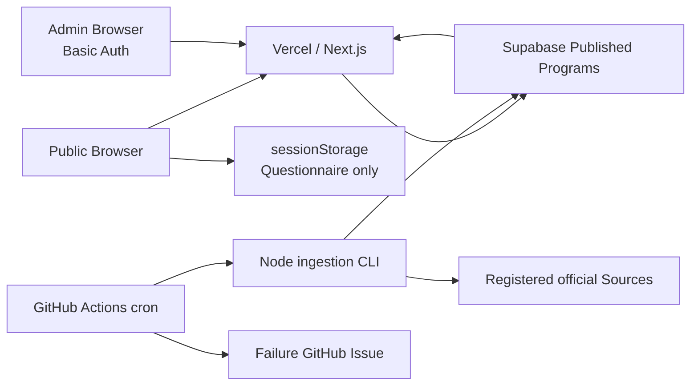

# Gov Welfare Architecture

> 最後更新：2026-08-23（Asia/Taipei）

## 結論

Production 使用單一 Next.js Repository、Vercel、Supabase PostgreSQL 與 GitHub Actions。官方 Source 成功擷取後自動更新 Published Program，不再經過人工 Review Queue；所有公開方案保留官方連結。Public questionnaire 在 Browser 執行，不保存使用者 Profile。

系統有 cron job，但使用 **GitHub Actions Scheduled workflow**，不是 Vercel Cron。

## System flow

目前沒有 Redis、Queue、Elasticsearch、Vector database、LLM Runtime、CMS 或 Microservices。

## Source pipeline

1. `sources` 記錄官方 URL、Authority、Jurisdiction、Adapter 與 `checkEveryHours`。
2. Scheduled workflow 只檢查 active 且到期的 Source；手動執行預設可強制檢查全部。
3. Adapter 保存 immutable `source_snapshots`，並將可解析資料寫入 `source_items`。
4. `source_items` 預設為 `descriptive_only` 與 Published；明確排除項目維持 `excluded`。
5. Auto-sync publisher 將最新 Snapshot、官方擷取文字與同步日期寫入新 `program_version` 並立即發布。
6. `data:audit` 確認 Published Evidence 指向最新 successful Snapshot、官方 URL 存在，且 Matchable Program 具有完整 Atomic rule evidence。

### 不自動做的事情

- 不從 HTML、PDF 或長文字猜測 Eligibility Rules。
- 不把 Competitive selection 說成錄取，也不把 Loan 說成核貸。
- Document monitor 沒有可靠正文時，只保存 hash、狀態與官方連結。
- 不擷取未登錄網站，不使用社群貼文作正式官方 Source。

### Failure behavior

- Fetch／parse 失敗：保留上一個 Published version，記錄 `last_check_error`。
- Supabase public read 失敗：回到 Repository Seed，避免整站中斷。
- Scheduled workflow 失敗：建立或更新單一 GitHub Issue；恢復後自動關閉。
- 不因錯誤回應、空內容或 404 自動刪除公開方案。

## Cron jobs

### Source checks

- Workflow：`.github/workflows/source-check.yml`
- Cron：`17 1 * * *`，名義上為台灣時間每日 09:17。
- GitHub schedule 為 best-effort，可能延遲。
- 順序：Fetch／persist → Auto-publish → Data audit。
- Artifact：`source-report.json`，保留 30 天。
- Manual input：`retry_failed_only` 可只重試失敗或已到期的 Source。

### 其他監控

- `.github/workflows/production-health.yml`：每 30 分鐘檢查 `/api/health`。
- `.github/workflows/activity-report-alert.yml`：每小時檢查未處理的活動回報。
- 通知透過 GitHub Issue；實際 Email／App notification 依 GitHub 個人設定。

## Database 保存什麼

Database 不保存性別、年齡、國籍、Questionnaire answers 或 Public user account。

| Table | 用途 |
| --- | --- |
| `sources` | Source registry、官方 URL、Adapter、頻率、最後成功與錯誤。 |
| `source_snapshots` | HTTP metadata、content hash、raw response、observed time。 |
| `source_items` | Adapter 擷取的官方項目與 unknown fields。 |
| `programs` | Stable identity、slug、Authority、Jurisdiction、Category。 |
| `program_versions` | Versioned public content、Rule tree、日期與 Publish state。 |
| `field_evidence` | Canonical field／Atomic rule 對應的 Source 與 Snapshot。 |
| `activity_reports` | 使用者回報與處理狀態。 |
| `reviews` | Legacy manual history 與現行 Auto-publish operation log；不再用作人工發布 Gate。 |

舊 Migration、Reviews 與 Drafts 不做破壞性刪除，以便 Backup、追查與必要時復原，但 Application 不再提供人工 Publish／Reject／Rollback UI。

## Public routes 與 cache

| Route | 行為 |
| --- | --- |
| `/`、`/find`、`/programs/[slug]` | Program store 使用 300 秒 cache。 |
| `/programs` | Query string 控制篩選、分頁、排序與 view mode。 |
| `/find` | Client-side matching；狀態保存在同一 tab 的 `sessionStorage`。 |
| `/admin` | Dynamic、Basic Auth；只顯示 Source health 與使用者回報。 |
| `/api/health` | `no-store`；回報 Database 與 Source failure。 |

## Rules 與 Auto sync 的邊界

- Auto sync 更新 Source Snapshot、正文摘錄、同步日期與 Structured passthrough content。
- 已有 Rule tree 的 Program 保留明確 Rules；Crawler 不改寫 Rule operators 或 thresholds。
- 沒有 Rule tree 的 Program 為 `descriptive_only`，只能出現在「其他官方方案」，不能顯示「基本條件符合」。
- Legacy `needs_review` content 在 Public runtime 會降為 `descriptive_only`，不再產生 Review 狀態。

## Security

- `SUPABASE_SERVICE_ROLE_KEY` 只存在 Server／GitHub Secrets，不進 Client bundle。
- Supabase RLS 只允許 Public 讀取 Published content。
- `/admin` 使用 `ADMIN_PASSWORD` HTTP Basic Auth；未設定時回應 503。
- Admin Server Action 會再次驗證 Authorization header。
- 目前共用密碼適合單人 MVP；多人營運時再導入 individual Auth。

## 仍需持續觀察

- GitHub scheduled ingestion 的實際延遲與 Source format drift。
- Raw snapshot retention 與 Supabase Storage migration。
- Browser E2E、mobile viewport、keyboard navigation 與 axe gate。
- CSP、rate limit 與 Admin brute-force protection。
- 地方政府 Coverage；目前不宣稱涵蓋全臺所有福利。
