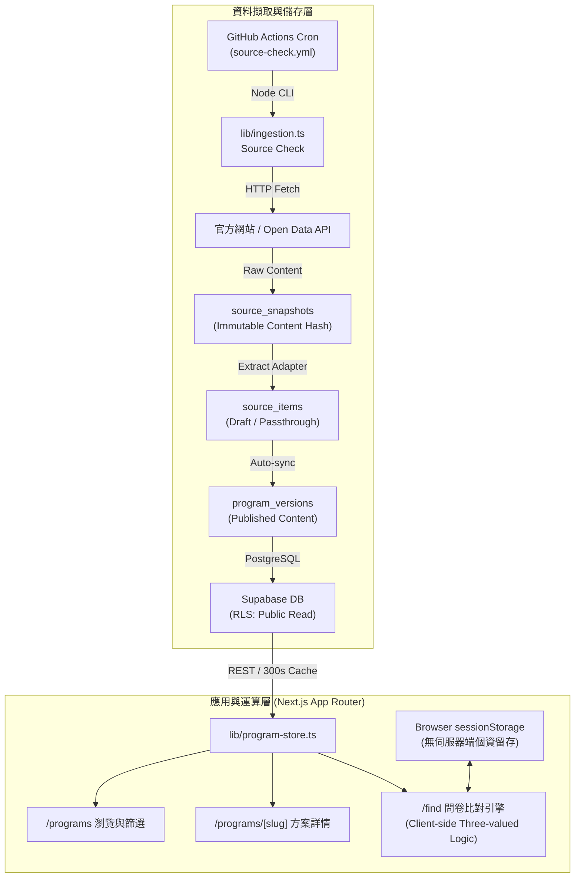
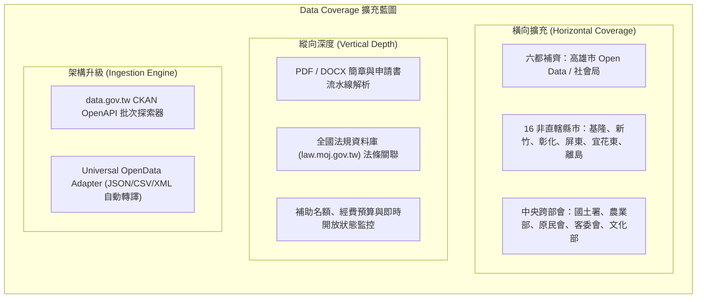
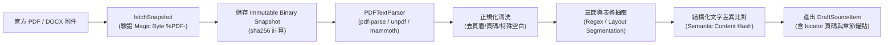
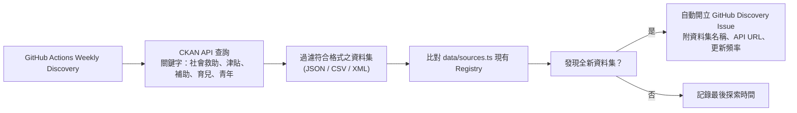
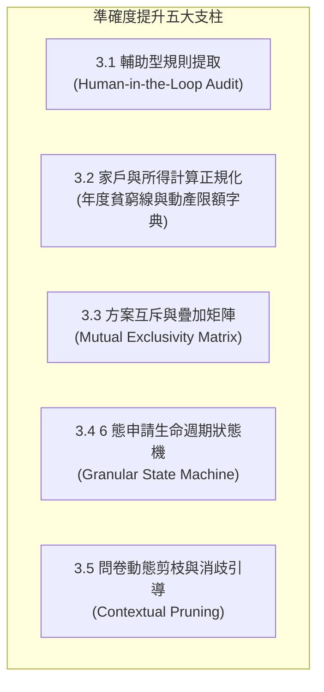
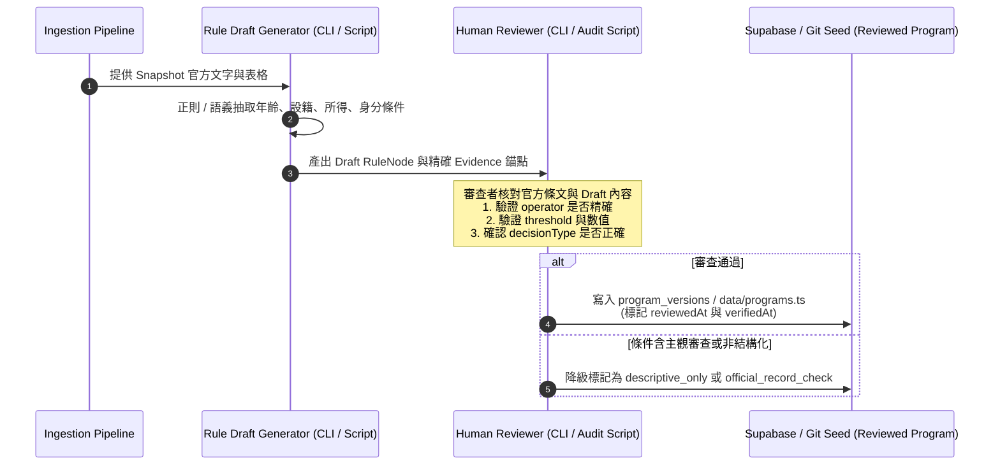
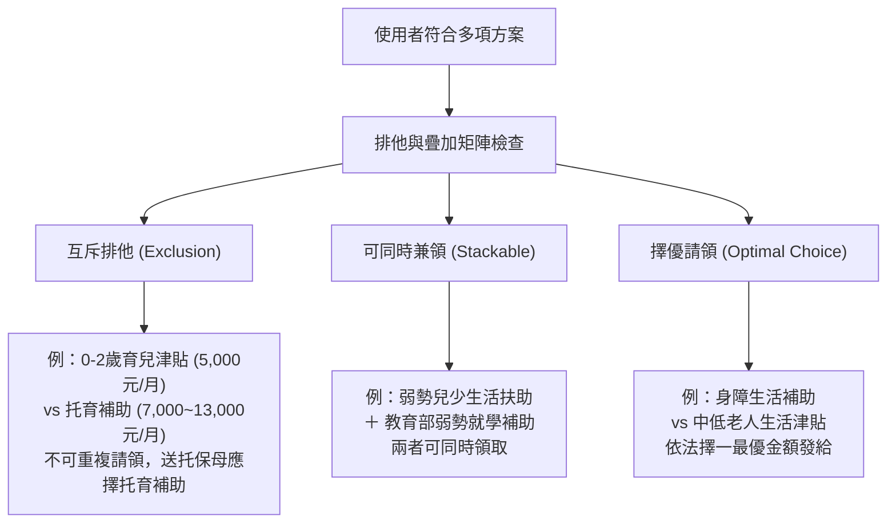
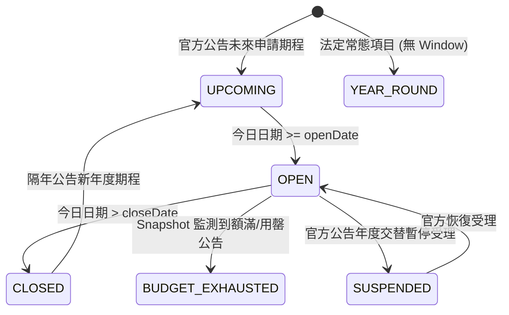
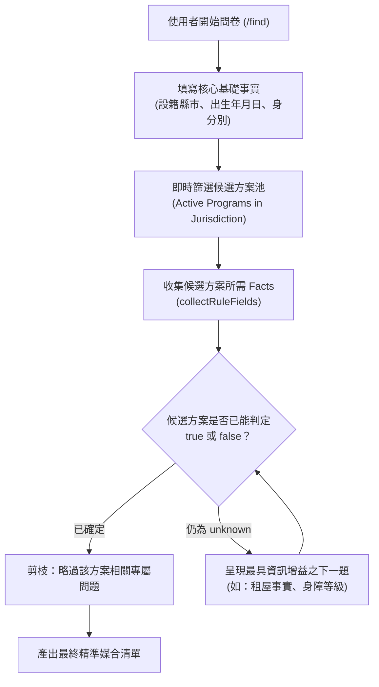
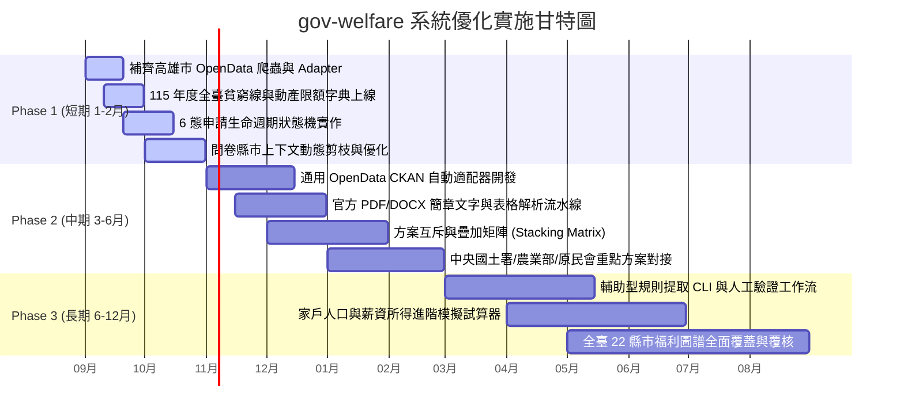

# 台灣政府福利與補助導航系統（gov-welfare）系統優化藍圖規劃

> 最後更新：2026-08-30（Asia/Taipei）  
> 適用版本：Next.js App Router / Supabase PostgreSQL / GitHub Actions Ingestion Pipeline  
> 核心目標：針對 Issue #4「**更多資料（Data Coverage）**」與「**準確度優化（Accuracy & Precision）**」兩大主軸，制定具備可執行性、向下相容性且嚴守架構不變量之系統進化藍圖。

---

## 目錄

- [一、 系統現況與核心原則分析](#一-系統現況與核心原則分析)
  - [1.1 現有架構總覽與關鍵優勢](#11-現有架構總覽與關鍵優勢)
  - [1.2 核心原則與架構不變量（Invariants）](#12-核心原則與架構不變量invariants)
  - [1.3 現有瓶頸與升級契機](#13-現有瓶頸與升級契機)
- [二、 面向一：更多資料（Data Coverage 擴充藍圖）](#二-面向一更多資料data-coverage-擴充藍圖)
  - [2.1 橫向涵蓋：地方政府與中央部會全面覆蓋](#21-橫向涵蓋地方政府與中央部會全面覆蓋)
    - [2.1.1 補齊六都最後拼圖：高雄市完整接入](#211-補齊六都最後拼圖高雄市完整接入)
    - [2.1.2 擴充非直轄市重要地方福利（16 縣市）](#212-擴充非直轄市重要地方福利16-縣市)
    - [2.1.3 深度擴充中央跨部會專案](#213-深度擴充中央跨部會專案)
  - [2.2 縱向深度：官方非結構化文本與法規關聯](#22-縱向深度官方非結構化文本與法規關聯)
    - [2.2.1 官方 PDF/DOCX 簡章與申請書文本解析流水線](#221-官方-pdfdocx-簡章與申請書文本解析流水線)
    - [2.2.2 全國法規資料庫（law.moj.gov.tw）法理依據關聯](#222-全國法規資料庫lawmojgovtw法理依據關聯)
    - [2.2.3 補助名額、預算額度與即時受理狀態監控](#223-補助名額預算額度與即時受理狀態監控)
  - [2.3 資料來源架構升級：自動探索與通用適配器](#23-資料來源架構升級自動探索與通用適配器)
    - [2.3.1 政府資料開放平臺（data.gov.tw）批次自動探索](#231-政府資料開放平臺datagovtw批次自動探索)
    - [2.3.2 通用 OpenData CKAN / API 自動適配器（Universal Adapter）](#232-通用-opendata-ckan--api-自動適配器universal-adapter)
- [三、 面向二：準確度優化（Accuracy & Precision）](#三-面向二準確度優化accuracy--precision)
  - [3.1 規則引擎升級：輔助型規則提取與三值邏輯演進](#31-規則引擎升級輔助型規則提取與三值邏輯演進)
    - [3.1.1 輔助型規則提取與人工驗證機制（Semi-automated Extraction + Human Verification）](#311-輔助型規則提取與人工驗證機制semi-automated-extraction--human-verification)
    - [3.1.2 規則樹擴充算子與嚴格型別校驗](#312-規則樹擴充算子與嚴格型別校驗)
  - [3.2 家戶與所得計算正規化：年度貧窮線與動態資產審查](#32-家戶與所得計算正規化年度貧窮線與動態資產審查)
    - [3.2.1 各縣市年度最低生活費與動產／不動產限額字典](#321-各縣市年度最低生活費與動產不動產限額字典)
    - [3.2.2 家戶人口計算與家庭總收入試算邏輯](#322-家戶人口計算與家庭總收入試算邏輯)
  - [3.3 方案互斥與疊加矩陣（Mutual Exclusivity & Stacking Matrix）](#33-方案互斥與疊加矩陣mutual-exclusivity--stacking-matrix)
    - [3.3.1 跨方案排他性與兼領規則建模](#331-跨方案排他性與兼領規則建模)
    - [3.3.2 資料庫綱要與關聯查詢支援](#332-資料庫綱要與關聯查詢支援)
    - [3.3.3 推薦與衝突提示 UI 呈現](#333-推薦與衝突提示-ui-呈現)
  - [3.4 申請狀態機精準化（State Machine）](#34-申請狀態機精準化state-machine)
    - [3.4.1 6 態申請生命週期定義](#341-6-態申請生命週期定義)
    - [3.4.2 狀態自動流轉與 Snapshot 變更觸發](#342-狀態自動流轉與-snapshot-變更觸發)
  - [3.5 資格初篩消歧與問卷動態剪枝（Dynamic Pruning）](#35-資格初篩消歧與問卷動態剪枝dynamic-pruning)
    - [3.5.1 依縣市／身分之適應性問卷題目動態剪枝](#351-依縣市身分之適應性問卷題目動態剪枝)
    - [3.5.2 資訊增益演算法與消歧引導](#352-資訊增益演算法與消歧引導)
- [四、 分階段落地藍圖（Roadmap）](#四-分階段落地藍圖roadmap)
  - [4.1 Phase 1：基礎加固與速贏（Short-term, 1–2 個月）](#41-phase-1基礎加固與速贏short-term-12-個月)
  - [4.2 Phase 2：資料擴張與矩陣建立（Mid-term, 3–6 個月）](#42-phase-2資料擴張與矩陣建立mid-term-36-個月)
  - [4.3 Phase 3：智慧輔助與深度試算（Long-term, 6–12 個月）](#43-phase-3智慧輔助與深度試算long-term-612-個月)
- [五、 結論與架構治理總結](#五-結論與架構治理總結)

---

## 一、 系統現況與核心原則分析

### 1.1 現有架構總覽與關鍵優勢

`gov-welfare` 專案目前採用現代化、精簡且極高穩定性的技術架構：



系統具備四大關鍵工程優勢：
1. **隱私零足跡（Privacy-by-Design）**：使用者的年齡、身分、所得、家庭狀態等問卷回答僅保存在瀏覽器端的 `sessionStorage`，後端資料庫不保存任何使用者個人識別資訊（PII）。
2. **三值邏輯比對引擎（Three-valued Logic Engine）**：採用嚴格的 `true | false | "unknown"` 判定，當使用者資料不足或方案條件含模糊評估時，標註為 `possible` 或 `review_required`，避免錯殺或誤導。
3. **不可變快照與證據追溯（Immutable Evidence-based Anchoring）**：每個方案欄位與規則皆綁定明確的 `source_id`、`snapshot_id`、`locator` 與 `extractedValue`，保證所有公開資訊具備官方憑據。
4. **高容錯降級機制（Graceful Degradation）**：若 Supabase 連線異常，系統具備靜態 Repository Seed（`data/programs.ts`）自動回退能力，保證服務永不斷線。

### 1.2 核心原則與架構不變量（Invariants）

在推動任何功能擴充與精準度優化時，必須嚴格遵守以下系統不變量：

| 原則 | 意涵與強制規範 | 違規樣態（嚴格禁止） |
| :--- | :--- | :--- |
| **Source-First** | 一切資料必須發源於可驗證之政府官方管道（機關網站、Open Data、公報、法規庫）。 | 採用未經授權之第三方論壇、社群貼文或無官方背書之爬蟲彙整資料。 |
| **不虛構規則**<br>*(No Hallucinated Rules)* | 規則引擎的 `RuleNode` 必須有確切官方文字支撐；模糊或主觀審查條件不可強行自動轉為布林規則。 | 使用 LLM 自行推導無依據的 threshold 或將審查制津貼標為 `entitlement`（法定給付）。 |
| **自動同步邊界**<br>*(Auto-sync Boundaries)* | 自動爬取只更新 Snapshot、文字摘錄、連結與 `descriptive_only` 方案；`matchable` 的結構化規則須由驗證流程治理。 | 爬蟲因網站文字變更而自動改寫 `RuleNode` 的運算子或臨界值，造成錯誤判讀。 |
| **三值邏輯安全**<br>*(Three-valued Safety)* | 條件不明時結果必須為 `unknown`；`all` 遇到 `unknown` 不得判定為 `true`；`any` 遇到 `unknown` 不得判定為 `false`。 | 缺漏欄位預設填入 `false` 導致使用者直接被排除在符合資格之外。 |

### 1.3 現有瓶頸與升級契機

根據現況程式碼庫（`lib/adapters.ts`、`data/sources.ts`、`data/programs.ts`、`lib/rules.ts`）的盤點，系統面臨以下擴充與精準度瓶頸：

1. **地理涵蓋不均**：六都中目前已串接臺北、新北、桃園、臺中、臺南，但**高雄市（全臺第三大人口都會區）尚未納入自動 Open Data 爬取適配器**；非直轄市（如基隆、新竹、彰化、屏東、花蓮等 16 縣市）尚缺乏系統化對接。
2. **中央重要方案缺漏**：國土署（300億租金補貼）、農業部（農保、老農津貼、農漁子女獎助金）、原民會（幼兒托育與急難救助）、文化部（文化幣）、客委會等跨部會重大民生專案尚待制度化爬取。
3. **官方非結構化附件處理成本高**：許多地方社會局將重要門檻與細則放在 PDF 簡章或 DOCX 申請表內，現有爬蟲僅監控 HTML 或單純下載 PDF，缺乏自動化文字與表格解析能力。
4. **缺乏方案互斥與疊加（Stacking & Exclusivity）矩陣**：例如「育兒津貼」與「托育補助」依法不得同時請領；「租金補貼」與「社會住宅包租代管」排他；使用者目前無法得知多個符合項目中哪些可兼領、哪些需擇一。
5. **問卷未依上下文動態剪枝**：使用者在 `/find` 填寫問卷時，無論選擇哪一個縣市，都會看到針對其他縣市的專屬問題（如特定地方弱勢加碼），造成作答負擔。
6. **年度貧窮線與動產／不動產門檻人工維護負擔**：每年 1 月衛福部與各縣市公告最新最低生活費（1.2倍、1.5倍、2.5倍及動產限額），目前缺乏正規化對照表自動計算。

---

## 二、 面向一：更多資料（Data Coverage 擴充藍圖）



### 2.1 橫向涵蓋：地方政府與中央部會全面覆蓋

#### 2.1.1 補齊六都最後拼圖：高雄市完整接入

高雄市政府資料開放平台（`data.kcg.gov.tw`）及社會局提供高達數十項社會福利資料集。新增 `kaohsiung_social_welfare_json` / `kaohsiung_welfare_csv` 適配器。

**預計接入之高雄市代表性重點福利方案：**
- 高雄市低收入戶與中低收入戶生活扶助與三節慰問金
- 高雄市生育津貼（第一名3萬、第二名3萬、第三名含以上4萬）與好孕成雙乘車券（28趟、每趟最高180元）
- 高雄市身心障礙者生活補助與日間照顧輔助
- 高雄市敬老卡搭乘公共運輸優惠與 65 歲以上老人健保自付額補助
- 高雄市弱勢兒童及少年生活扶助與早期療育費用補助
- 高雄市青年租金補貼（加碼專案）與首購房屋貸款利息補貼

**高雄市 Source Adapter 介面設計（`lib/adapters.ts` 擴充）：**

```typescript
// 擴充 SourceConfig["adapterKey"]
export type AdapterKey =
  | "taoyuan_welfare_json"
  | "new_taipei_welfare_csv"
  | "taipei_social_aid_csv"
  | "taichung_social_aid_json"
  | "tainan_social_welfare_json"
  | "kaohsiung_social_welfare_json" // 新增
  | "universal_opendata_ckan"       // 新增通用適配器
  | "document_monitor"
  | "official_page"
  | "manual";

const kaohsiungFields = new Set([
  "補助項目", "給付對象與條件", "補助金額", "應備文件", 
  "受理單位", "聯絡電話", "法規依據", "更新日期", "線上申辦網址"
]);

export function extractKaohsiungRows(body: string): DraftSourceItem[] {
  const parsed: unknown = JSON.parse(body.replace(/^\uFEFF/, ""));
  if (!Array.isArray(parsed)) throw new Error("高雄 Source format changed: expected a JSON array");
  
  return parsed.map((value, index) => {
    const row = objectRecord(value);
    if (!row || typeof row["補助項目"] !== "string") {
      throw new Error(`高雄 row ${index} 缺少補助項目名稱`);
    }
    const title = cleanText(row["補助項目"]);
    return {
      externalId: typeof row["線上申辦網址"] === "string" && row["線上申辦網址"]
        ? row["線上申辦網址"]
        : `kcg:${index}:${title}`,
      title,
      raw: row,
      canonicalDraft: {
        title,
        eligibilityText: cleanText(String(row["給付對象與條件"] ?? "")),
        benefitSummary: cleanText(String(row["補助金額"] ?? "")),
        documentsText: cleanText(String(row["應備文件"] ?? "")),
        authority: cleanText(String(row["受理單位"] ?? "高雄市政府社會局")),
        contactText: cleanText(String(row["聯絡電話"] ?? "")),
        applicationUrl: cleanText(String(row["線上申辦網址"] ?? "")) || null,
        resourceModifiedAt: cleanText(String(row["更新日期"] ?? "")) || null,
      },
      unknownFields: Object.fromEntries(
        Object.entries(row).filter(([key]) => !kaohsiungFields.has(key))
      ),
      reviewStatus: "pending",
      warnings: ["government_api_passthrough", "draft_never_auto_publish"],
    };
  });
}
```

#### 2.1.2 擴充非直轄市重要地方福利（16 縣市）

臺灣 16 個非直轄縣市在弱勢扶助、生育津貼、學生就學交通補助、長者三節禮金與身障照護上有鮮明的地方政策特色。將分群逐步建立爬取管道：

1. **北基桃竹苗生活圈**：
   - **基隆市**：基隆市育兒津貼加碼、身障者三節慰問金、基隆好運孕婦產檢乘車券。
   - **新竹市／新竹縣**：新竹市好凍卵補助、婦女生育津貼、幼兒教保券、重陽敬老金。
   - **苗栗縣**：苗栗縣婦女生育津貼、身障日間照顧及住宿式照顧補助。
2. **中彰投雲嘉生活圈**：
   - **彰化縣**：彰化縣長青福利卡加碼（搭客運、折抵醫療費）、萬人健檢補助、婦女生育獎勵金。
   - **南投縣**：南投縣育兒津貼、偏遠地區醫療交通補助、敬老愛心卡搭計程車補貼。
   - **雲林縣**：雲林縣萬得福生育津貼（前三胎加碼專案）、祖孫托育育兒補助。
   - **嘉義市／嘉義縣**：嘉義市育兒津貼、中高齡健康檢查補助、婦女孕期營養品補貼。
3. **高屏與東部生活圈**：
   - **屏東縣**：屏東縣育兒津貼、婦女產檢交通補助、身心障礙者托育養護補助。
   - **宜蘭縣**：宜蘭縣產婦營養補貼、敬老愛心卡乘車折抵、弱勢學生免費營養午餐。
   - **花蓮縣／臺東縣**：急難救助特別專案、偏遠地區就醫交通費補貼、原住民老人假牙補助。
4. **離島三縣（金門、連江、澎湖）**：
   - **金門縣**：金門縣歷經戰地政務時期三節慰問金、全職媽媽育兒津貼、就讀大專院校學生交通圖書券、離島醫療轉診全額交通補助。
   - **連江縣（馬祖）**：連江縣生育獎勵金（最高第3胎8萬）、離島病患後送與家屬交通住宿補助。
   - **澎湖縣**：澎湖縣長者敬老三節禮金、大專學生返鄉交通補貼。

#### 2.1.3 深度擴充中央跨部會專案

中央各部會補助是多數民眾主要受惠來源，需在 `data/sources.ts` 與 `data/programs.ts` 系統化擴充下列部會的專案：

| 主管部會 | 重點計畫／專案名稱 | 補助類型（Benefit Type） | 目標族群與重要條件特徵 |
| :--- | :--- | :--- | :--- |
| **內政部國土管理署** | 300億元中央擴大租金補貼專案計畫 | `subsidy`（租金補貼） | 滿18歲以上租屋族、家庭成員無自用住宅、每人每月所得在各地最低生活費3倍以下；單身青年、新婚、育幼、弱勢享1.2~1.8倍加碼。 |
| **內政部國土管理署** | 青年安心成家購屋優惠貸款（新青安） | `loan`（利息補貼貸款） | 成年國民、本人配偶及未成年子女名下無自用住宅；最高額度、寬限期與利息補貼。 |
| **農業部** | 農民健康保險與老農津貼 | `allowance`（津貼津給） | 年滿65歲、農保年資合計15年以上或投保滿一定年限之實際從農者，每月發給固定津貼。 |
| **農業部** | 農漁民子女助學金 | `scholarship`（就學獎助） | 參加農保或漁會甲類會員之農漁民，其子女就讀國內高中職或大專院校，成績符合標準且所得在一定限額以下。 |
| **農業部農村發展及水土保持署** | 青年回留農村創新研究與實踐計畫 | `grant`（補助款） | 18至45歲青年，提案推動農村產業升級、生態永續或文化保存，最高補助80萬元。 |
| **原住民族委員會** | 原住民幼兒就讀幼兒園補助 | `subsidy`（學費補助） | 滿2足歲至未滿5足歲之原住民幼兒，就讀公私立幼兒園每學期定額補助。 |
| **原住民族委員會** | 原住民族專案急難救助 | `cash`（一次性救助金） | 原住民遭遇重大傷病、死亡、非自願失業或天災導致生活陷入困境者。 |
| **客家委員會** | 客語能力認證獎學金 | `scholarship`（獎勵金） | 通過初級、中級、中高級、高級客語能力認證之十九歲以下學生或民眾。 |
| **文化部** | 文化成年禮金（文化幣） | `in_kind`（點數折抵券） | 16歲至22歲青年，每年發放1,200點文化幣，專用於藝文表演、展覽、購書與文創消費。 |
| **勞動部勞動力發展署** | 青年跨域就業津貼 | `subsidy`（交通／搬遷／租屋） | 18至29歲初次尋職青年，經公立就業服務機構推介至離家30公里以上地點就業。 |

---

### 2.2 縱向深度：官方非結構化文本與法規關聯

#### 2.2.1 官方 PDF/DOCX 簡章與申請書文本解析流水線

政府網站（尤其是中央部會徵件、留學獎學金、公營補助要點）常以 PDF / DOCX 格式發布「申請須知」或「申請簡章」。現行系統僅能儲存 base64 snapshot 或單純以 hash 監控。

**升級後的非結構化文本解析流水線（Ingestion Pipeline Extension）：**



**實作技術規範：**
1. **依賴封裝**：使用免外部二進位依賴之純 TypeScript 解析器（如 `unpdf` 或 `pdf-parse` 解析 PDF，`mammoth` 解析 DOCX），保證在 Node.js / GitHub Actions 環境中無縫執行。
2. **章節語義分塊（Semantic Section Extraction）**：
   - 識別「壹、申請資格」、「貳、補助額度」、「參、申請期間」、「肆、應備文件」等中文大綱標題。
   - 保留頁碼資訊，將 `locator` 自動標記為 `PDF 第 X 頁／第 Y 條`。
3. **表格資料提取（Table Matrix Extraction）**：
   - 針對補助金額級距表（如：低收入戶依款別發給金額表、身障等級補助對照表），將文字網格轉為 JSON 鍵值對結構，納入 `canonicalDraft`。

#### 2.2.2 全國法規資料庫（law.moj.gov.tw）法理依據關聯

各項社會救助與津貼多有上位法律與授權法規命令依據。建立專屬法規關聯字典，增強方案的公信力與條件精準度：

```typescript
export type LegalBasisRef = {
  lawName: string;       // 法規名稱，例如 "社會救助法"
  article: string;       // 條號，例如 "第 4 條"、"第 5 條之 2"
  lawUrl: string;        // 全國法規資料庫連結
  summary: string;       // 法條核心摘要
};

// 核心母法標準清單
export const CORE_LEGAL_BASES: Record<string, LegalBasisRef> = {
  social_assistance_act_4: {
    lawName: "社會救助法",
    article: "第 4 條",
    lawUrl: "https://law.moj.gov.tw/LawClass/LawSingle.aspx?pcode=D0050078&flno=4",
    summary: "低收入戶及中低收入戶最低生活費計算標準與審查門檻定義",
  },
  disability_rights_act_71: {
    lawName: "身心障礙者權益保障法",
    article: "第 71 條",
    lawUrl: "https://law.moj.gov.tw/LawClass/LawSingle.aspx?pcode=D0050046&flno=71",
    summary: "身心障礙者生活補助、托育養護費及各項津貼請領法源",
  },
  senior_citizens_welfare_act_12: {
    lawName: "老人福利法",
    article: "第 12 條",
    lawUrl: "https://law.moj.gov.tw/LawClass/LawSingle.aspx?pcode=D0050037&flno=12",
    summary: "中低收入老人生活津貼發放基準與排他原則",
  },
  children_welfare_act_23: {
    lawName: "兒童及少年福利與權益保障法",
    article: "第 23 條",
    lawUrl: "https://law.moj.gov.tw/LawClass/LawSingle.aspx?pcode=D0050001&flno=23",
    summary: "弱勢兒童及少年生活扶助、醫療補助與早療服務法源",
  },
};
```

#### 2.2.3 補助名額、經費預算與即時受理狀態監控

特定競爭型（`competitive_selection`）或額額有限之補助（如：節能家電補助、老舊車輛汰換、文化部青年創作補助、地方青年創業補助）具備「名額有限，用罄即止」之特性。

**監控機制設計：**
1. **動態標籤與欄位**：在 `Program` 型別中擴充 `quotaStatus?: { totalQuota?: number; remainingQuota?: number; budgetExhausted: boolean; lastUpdatedAt: string; }`。
2. **官網狀態文字正則擷取（Pattern Matching on Source Text）**：
   - 監控正則關鍵字：`/(已額滿|預算用罄|停止受理|申請件數已達上限|暫停收件)/i`。
   - 一旦在 Official Source Snapshot 監測到用罄關鍵字，系統在自動同步時自動將該方案標註為 `budget_exhausted`，並在前端標明「官方公告經費已用罄，暫停受理」。

---

### 2.3 資料來源架構升級：自動探索與通用適配器

#### 2.3.1 政府資料開放平臺（data.gov.tw）批次自動探索

政府資料開放平臺擁有超過 50,000+ 筆 Open Data，每日皆有新增與異動。透過平臺的 CKAN API（`https://data.gov.tw/api/v2/rest/dataset-search`），可定期執行自動探索任務：



#### 2.3.2 通用 OpenData CKAN / API 自動適配器（Universal Adapter）

為避免每增加一個地方政府或機關就必須撰寫全新 Adapter 程式碼，設計 `universal_opendata_ckan` 適配器，利用欄位同義詞字典（Field Synonym Mapping Dictionary）自動完成映射：

```typescript
// 欄位同義詞映射字典
const FIELD_SYNONYM_MAP = {
  title: ["補助名稱", "計畫名稱", "服務名稱", "項目名稱", "policyName", "name", "title", "title_tw"],
  summary: ["補助內容", "服務說明", "簡介", "政策說明", "policyDescription", "service_desc", "description"],
  eligibility: ["申請資格", "補助對象", "給付對象", "資格條件", "eligibilityCriteria", "eligibility", "condition"],
  benefitSummary: ["補助金額", "補助標準", "給付額度", "給付標準", "benefit", "amount"],
  documents: ["應備文件", "應檢附文件", "應附證明", "requiredDocuments", "documents"],
  authority: ["主辦單位", "受理單位", "洽辦單位", "機關名稱", "agencyName", "authority"],
  applicationUrl: ["線上申辦", "申辦網址", "相關資訊連結", "詳細資訊網址", "sourceUrl", "url", "curl"],
  applicationMethod: ["申請方式", "辦理方式", "申請手續", "applicationMethod"],
  contact: ["聯絡電話", "聯繫方式", "諮詢電話", "telephone", "contactPhone"],
};

export function extractUniversalOpenDataRows(body: string, format: "json" | "csv"): DraftSourceItem[] {
  let records: Record<string, unknown>[] = [];
  if (format === "json") {
    const parsed = JSON.parse(body.replace(/^\uFEFF/, ""));
    records = Array.isArray(parsed) ? parsed : (Array.isArray(parsed.data) ? parsed.data : [parsed]);
  } else {
    records = parseCsvRecords(body);
  }

  return records.map((row, index) => {
    const getField = (keys: string[]): string | null => {
      for (const key of keys) {
        if (row[key] !== undefined && row[key] !== null && String(row[key]).trim() !== "") {
          return cleanText(String(row[key]));
        }
      }
      return null;
    };

    const title = getField(FIELD_SYNONYM_MAP.title) ?? `未命名方案 ${index + 1}`;
    const applicationUrl = getField(FIELD_SYNONYM_MAP.applicationUrl);

    return {
      externalId: applicationUrl || `universal:${index}:${title}`,
      title,
      raw: row,
      canonicalDraft: {
        title,
        summary: getField(FIELD_SYNONYM_MAP.summary),
        eligibilityText: getField(FIELD_SYNONYM_MAP.eligibility),
        benefitSummary: getField(FIELD_SYNONYM_MAP.benefitSummary),
        documentsText: getField(FIELD_SYNONYM_MAP.documents),
        authority: getField(FIELD_SYNONYM_MAP.authority),
        applicationMethod: getField(FIELD_SYNONYM_MAP.applicationMethod),
        contactText: getField(FIELD_SYNONYM_MAP.contact),
        applicationUrl,
      },
      unknownFields: row,
      reviewStatus: "pending",
      warnings: ["universal_adapter_auto_mapped", "draft_never_auto_publish"],
    };
  });
}
```

---

## 三、 面向二：準確度優化（Accuracy & Precision）



### 3.1 規則引擎升級：輔助型規則提取與三值邏輯演進

#### 3.1.1 輔助型規則提取與人工驗證機制（Semi-automated Extraction + Human Verification）

專案嚴格貫徹「**不虛構規則**」之鐵律。為了兼顧資料擴充速度與 100% 規則精準度，建構「**輔助型規則提取（Semi-automated Rule Extraction with Human Verification）**」流程：



**草稿產生與審查工具規範（`scripts/draft-rules.ts`）：**
- 工具僅產生暫存建議（Proposal），嚴禁未經審查直接寫入生產環境 `program_versions`。
- 所有輸出的 Atomic Rule 必須自帶 `evidence` 物件，填入對應的 `sourceId`、`locator` 與 `extractedValue`。

#### 3.1.2 規則樹擴充算子與嚴格型別校驗

現有 `AtomicOperator`（`eq`, `neq`, `in`, `gte`, `gt`, `lte`, `lt`, `between`, `date_within_past_years`, `date_on_or_before_years_ago`）非常嚴謹，為因應更複雜的法規邏輯，規劃擴充下列算子：

```typescript
export type ExtendedAtomicOperator =
  | AtomicOperator
  // 新增：陣列包含任一或全部
  | "array_contains_any"     // 例如：使用者具備身分列表包含 ["disability", "indigenous"] 任一
  | "array_contains_all"     // 例如：同時具備多重指定資格
  // 新增：縣市比對（支援北北基桃共同生活圈等複合條件）
  | "city_in_region"         // 例如：設籍或居住於 "northern_taiwan"
  // 新增：收入倍數比對（動態按縣市最低生活費計算）
  | "income_below_poverty_multiple"; // 例如：低於該縣市最低生活費 1.5 倍

// 強化比對函式（lib/rules.ts 擴充）
function compareExtendedAtomic(rule: AtomicRule, facts: ProfileFacts, asOf: string): TruthValue {
  // 原有算子邏輯維持 100% 向下相容...
  if (rule.operator === "array_contains_any") {
    const actual = factValue(rule.field, facts, asOf);
    if (actual === undefined || actual === null) return "unknown";
    if (!Array.isArray(actual) || !Array.isArray(rule.value)) return false;
    return (rule.value as unknown[]).some((item) => actual.includes(item as never));
  }
  // 更多擴充算子實作...
  return "unknown";
}
```

---

### 3.2 家戶與所得計算正規化：年度貧窮線與動態資產審查

#### 3.2.1 各縣市年度最低生活費與動產／不動產限額字典

臺灣社會救助體系（低收入戶、中低收入戶、弱勢兒少、長者生活津貼、租金補貼）以各直轄市與縣市每年公告之「最低生活費（Poverty Line）」為基準。

建立標準化年度字典（`data/poverty-thresholds.ts`），支援自動計算：

```typescript
export type CountyPovertyStandard = {
  year: number;                    // 民國年，例如 115
  effectiveYearAD: number;         // 西元年，例如 2026
  countyKey: string;               // 縣市代碼，例如 "taipei", "new_taipei"
  countyName: string;              // 縣市名稱
  minimumLivingExpense: number;    // 最低生活費（元/人/月）
  lowIncomeAssetLimit: {
    movablePerPerson: number;      // 動產限額（元/人）
    immovablePerHousehold: number; // 不動產限額（元/戶）
  };
  midLowIncomeExpenseMultiple: number; // 中低收入戶標準（通常為 1.5 倍）
  midLowIncomeAssetLimit: {
    movablePerPerson: number;      // 中低收動產限額（元/人）
    immovablePerHousehold: number; // 中低收不動產限額（元/戶）
  };
  rentSubsidyIncomeMultiple: number;   // 國土署租金補貼門檻（通常為 3 倍）
  officialAnnouncementUrl: string; // 衛福部/縣市政府公告公報連結
};

// 115 年度（2026）各縣市標準字典定義
export const POVERTY_STANDARDS_115: Record<string, CountyPovertyStandard> = {
  taipei: {
    year: 115,
    effectiveYearAD: 2026,
    countyKey: "taipei",
    countyName: "臺北市",
    minimumLivingExpense: 20437,
    lowIncomeAssetLimit: { movablePerPerson: 165000, immovablePerHousehold: 8800000 },
    midLowIncomeExpenseMultiple: 1.5,
    midLowIncomeAssetLimit: { movablePerPerson: 247500, immovablePerHousehold: 13200000 },
    rentSubsidyIncomeMultiple: 3.0,
    officialAnnouncementUrl: "https://dosw.gov.taipei/...",
  },
  new_taipei: {
    year: 115,
    effectiveYearAD: 2026,
    countyKey: "new_taipei",
    countyName: "新北市",
    minimumLivingExpense: 16400,
    lowIncomeAssetLimit: { movablePerPerson: 100000, immovablePerHousehold: 4500000 },
    midLowIncomeExpenseMultiple: 1.5,
    midLowIncomeAssetLimit: { movablePerPerson: 150000, immovablePerHousehold: 6500000 },
    rentSubsidyIncomeMultiple: 3.0,
    officialAnnouncementUrl: "https://www.sw.ntpc.gov.tw/...",
  },
  // 涵蓋全臺 22 縣市...
};
```

#### 3.2.2 家戶人口計算與家庭總收入試算邏輯

社會救助法第 5 條對於「應計算人口範圍」有嚴格法定定義（包含配偶、一親等直系血親、同一戶籍共同生活之直系血親等，但排除服兵役、在學受領公費、入獄服刑等）。

**計算正規化模組（`lib/household-calculator.ts`）：**

```typescript
export type HouseholdMember = {
  relation: "applicant" | "spouse" | "parent" | "child" | "cohabiting_relative";
  age: number;
  monthlyIncome: number;
  isWorkingAge: boolean;         // 16~64歲具工作能力者
  hasDisability: boolean;        // 身心障礙
  isEnrolledStudent: boolean;    // 日間部在學
  isExempted: boolean;           // 是否符合法定免計人口事由
};

export type HouseholdEvaluationInput = {
  residenceCity: string;
  members: HouseholdMember[];
  householdMovableAssets: number;   // 動產總額（存款、股票等）
  householdImmovableAssets: number; // 不動產總額（公告現值）
};

export type HouseholdEvaluationResult = {
  includedMemberCount: number;
  totalMonthlyIncome: number;
  averageMonthlyIncomePerPerson: number;
  povertyStandard: CountyPovertyStandard;
  qualifiesLowIncome: boolean | "unknown";
  qualifiesMidLowIncome: boolean | "unknown";
  disqualificationReasons: string[];
};

export function evaluateHouseholdEligibility(
  input: HouseholdEvaluationInput,
  standard: CountyPovertyStandard
): HouseholdEvaluationResult {
  const activeMembers = input.members.filter((m) => !m.isExempted);
  const count = activeMembers.length;
  if (count === 0) {
    return {
      includedMemberCount: 0,
      totalMonthlyIncome: 0,
      averageMonthlyIncomePerPerson: 0,
      povertyStandard: standard,
      qualifiesLowIncome: "unknown",
      qualifiesMidLowIncome: "unknown",
      disqualificationReasons: ["應計人口數為 0，請確認家庭成員資料"],
    };
  }

  // 計算工作能力基本收入設算（依社會救助法第 5-1 條規定）
  const totalIncome = activeMembers.reduce((sum, member) => {
    let income = member.monthlyIncome;
    // 若 16~64 歲具工作能力且無薪資所得，依法核算基本工資或平均薪資
    if (member.isWorkingAge && !member.hasDisability && !member.isEnrolledStudent && income === 0) {
      income = 28590; // 依法定基本工資設算
    }
    return sum + income;
  }, 0);

  const avgIncome = totalIncome / count;
  const movablePerPerson = input.householdMovableAssets / count;
  const reasons: string[] = [];

  const incomeLowOk = avgIncome <= standard.minimumLivingExpense;
  const movableLowOk = movablePerPerson <= standard.lowIncomeAssetLimit.movablePerPerson;
  const immovableLowOk = input.householdImmovableAssets <= standard.lowIncomeAssetLimit.immovablePerHousehold;

  if (!incomeLowOk) reasons.push(`每人每月平均所得 (${avgIncome.toLocaleString()}元) 超過最低生活費 (${standard.minimumLivingExpense.toLocaleString()}元)`);
  if (!movableLowOk) reasons.push(`每人平均動產 (${movablePerPerson.toLocaleString()}元) 超過動產限額 (${standard.lowIncomeAssetLimit.movablePerPerson.toLocaleString()}元)`);
  if (!immovableLowOk) reasons.push(`家庭不動產總額 (${input.householdImmovableAssets.toLocaleString()}元) 超過不動產限額 (${standard.lowIncomeAssetLimit.immovablePerHousehold.toLocaleString()}元)`);

  return {
    includedMemberCount: count,
    totalMonthlyIncome: totalIncome,
    averageMonthlyIncomePerPerson: avgIncome,
    povertyStandard: standard,
    qualifiesLowIncome: incomeLowOk && movableLowOk && immovableLowOk,
    qualifiesMidLowIncome: avgIncome <= standard.minimumLivingExpense * standard.midLowIncomeExpenseMultiple,
    disqualificationReasons: reasons,
  };
}
```

---

### 3.3 方案互斥與疊加矩陣（Mutual Exclusivity & Stacking Matrix）

#### 3.3.1 跨方案排他性與兼領規則建模

政府福利津貼多有「不得重複請領」或「擇優請領」之排他條款。使用者若同時符合多項，系統應清楚指出方案間的關係。



**關係型別定義（`lib/domain.ts` 擴充）：**

```typescript
export type ProgramRelationshipType =
  | "mutually_exclusive"  // 絕對排他（完全不可兼領）
  | "stackable"           // 可全額疊加兼領
  | "choose_optimal"      // 擇一請領（通常系統自動計算最高金額）
  | "deductible_topup";   // 差額補助（例如 A 方案領取後，B 方案僅補足差額）

export type ProgramRelationship = {
  sourceProgramSlug: string;
  targetProgramSlug: string;
  relationshipType: ProgramRelationshipType;
  legalRationale: string;  // 法規或簡章依據
  guidanceText: string;    // 給使用者的清晰指引說明
  evidence: Evidence;
};
```

#### 3.3.2 資料庫綱要與關聯查詢支援

在 Supabase 資料庫建立 `program_relationships` 資料表：

```sql
-- Migration: 0010_program_relationships.sql
CREATE TABLE IF NOT EXISTS public.program_relationships (
  id UUID PRIMARY KEY DEFAULT gen_random_uuid(),
  source_program_slug TEXT NOT NULL REFERENCES public.programs(slug) ON DELETE CASCADE,
  target_program_slug TEXT NOT NULL REFERENCES public.programs(slug) ON DELETE CASCADE,
  relationship_type TEXT NOT NULL CHECK (relationship_type IN ('mutually_exclusive', 'stackable', 'choose_optimal', 'deductible_topup')),
  legal_rationale TEXT NOT NULL,
  guidance_text TEXT NOT NULL,
  evidence JSONB NOT NULL DEFAULT '{}'::JSONB,
  created_at TIMESTAMPTZ NOT NULL DEFAULT timezone('utc'::text, now()),
  CONSTRAINT unique_program_pair UNIQUE (source_program_slug, target_program_slug)
);

CREATE INDEX IF NOT EXISTS idx_program_rel_source ON public.program_relationships(source_program_slug);
CREATE INDEX IF NOT EXISTS idx_program_rel_target ON public.program_relationships(target_program_slug);

-- RLS: 公開讀取
ALTER TABLE public.program_relationships ENABLE ROW LEVEL SECURITY;
CREATE POLICY "Allow public read on program_relationships" ON public.program_relationships
  FOR SELECT USING (true);
```

#### 3.3.3 推薦與衝突提示 UI 呈現

在 `/find` 媒合結果與 `/programs/[slug]` 詳情頁中：
- 當使用者同時符合「育兒津貼」與「托育補助」時，UI 提示：  
  ⚠️ **注意：本方案與「未滿 2 歲托育補助」不得重複請領。若幼兒已送托準公共保母／托嬰中心，請優先申請托育補助（每月 13,000 元起）。**
- 當使用者符合「低收入戶生活扶助」與「中央租金補貼」時，UI 提示：  
  💡 **利多提示：本方案可與「300 億元中央擴大租金補貼」同時請領，且租金補貼享有弱勢身分加碼 1.4 倍。**

---

### 3.4 申請狀態機精準化（State Machine）

#### 3.4.1 6 態申請生命週期定義

現有系統的狀態較為單純（`eligible`, `possible`, `ineligible`, `review_required`, `closed`, `descriptive`），無法充分反映「即將開始」、「經費用罄」、「常年受理」等實務狀態。

升級為 **6 態申請生命週期狀態機**：

| 狀態代碼 | 狀態名稱 | 定義與觸發條件 | 使用者指引與 UI 標籤 |
| :--- | :--- | :--- | :--- |
| `OPEN` | **受理申請中** | 當前日期在 `applicationWindow` 內，且無暫停／額滿公告。 | 🟢 綠色標籤「受理申請中」，顯示截止倒數天數。 |
| `UPCOMING` | **即將開放** | 官方已發布簡章或公報，但 `asOf < applicationWindow.open`。 | 🔵 藍色標籤「即將開放」，顯示開始受理日期與預備文件清單。 |
| `CLOSED` | **已截止／逾期** | `asOf > applicationWindow.close` 或方案已封存。 | ⚪ 灰色標籤「本期已截止」，提供過往參考資訊與下期預告訂閱。 |
| `BUDGET_EXHAUSTED` | **經費用罄提前截止** | 官方網站公告「申請額滿」或「補助經費用罄」。 | 🔴 紅色標籤「名額已額滿／預算用罄」，提醒勿白跑一趟。 |
| `SUSPENDED` | **暫停受理／審核中** | 機關進行系統維護、年度預算交替或法規修訂期間暫停受理。 | 🟡 黃色標籤「暫停受理」，提示預計恢復時間。 |
| `YEAR_ROUND` | **常態受理／隨到隨辦** | 無特定申請期限之法定給付（如常態低收申請、身障補助）。 | 🟢 綠色標籤「常態受理／隨到隨辦」。 |

#### 3.4.2 狀態自動流轉與 Snapshot 變更觸發



**狀態判定核心函式（`lib/rules.ts` 演進）：**

```typescript
export type ApplicationLifecycleStatus =
  | "OPEN"
  | "UPCOMING"
  | "CLOSED"
  | "BUDGET_EXHAUSTED"
  | "SUSPENDED"
  | "YEAR_ROUND";

export function resolveApplicationStatus(program: Program, asOf = todayInTaiwan()): ApplicationLifecycleStatus {
  if (program.coverage === "archived") return "CLOSED";
  
  // 檢查是否標記預算用罄或暫停
  if (program.tags?.includes("budget_exhausted")) return "BUDGET_EXHAUSTED";
  if (program.tags?.includes("suspended")) return "SUSPENDED";

  const window = program.applicationWindow;
  if (!window || (!window.open && !window.close)) {
    // 若有有效期間且已逾期
    if (program.effectiveTo && asOf > program.effectiveTo) return "CLOSED";
    return "YEAR_ROUND";
  }

  if (window.open && asOf < window.open) return "UPCOMING";
  if (window.close && asOf > window.close) return "CLOSED";
  return "OPEN";
}
```

---

### 3.5 資格初篩消歧與問卷動態剪枝（Dynamic Pruning）

#### 3.5.1 依縣市／身分之適應性問卷題目動態剪枝

現行 `/find` 包含 30+ 題 Fact 問題（`data/facts.ts`）。若使用者一開始選擇「新北市」，系統不應繼續詢問「是否設籍臺北市滿 1 年」或「是否具有臺中市特有愛心卡」等無效題目。

**問卷動態剪枝流程圖：**



#### 3.5.2 資訊增益演算法與消歧引導

```typescript
// lib/questionnaire-pruning.ts
import { collectRuleFields } from "@/lib/rules";
import type { FactDefinition, ProfileFacts, Program } from "@/lib/domain";

export function getRelevantFactQuestions(
  allPrograms: Program[],
  currentFacts: ProfileFacts,
  allFactDefinitions: FactDefinition[]
): FactDefinition[] {
  const selectedCity = currentFacts.residence_city as string | undefined;

  // 1. 先過濾出與目前縣市相符（或中央部會）且處於可媒合狀態之方案
  const candidatePrograms = allPrograms.filter((p) => {
    if (p.coverage !== "matchable" || !p.rule) return false;
    if (!selectedCity) return true;
    return p.jurisdiction === "central" || p.jurisdiction === selectedCity;
  });

  // 2. 收集所有候選方案規則中所引用之欄位集合
  const neededFields = new Set<string>();
  for (const program of candidatePrograms) {
    const fields = collectRuleFields(program.rule);
    for (const field of fields) neededFields.add(field);
  }

  // 3. 核心題目一律保留；非核心題目僅在候選方案需要時才出現
  return allFactDefinitions.filter((definition) => {
    if (definition.core) return true;
    return neededFields.has(definition.key);
  });
}
```

---

## 四、 分階段落地藍圖（Roadmap）



### 4.1 Phase 1：基礎加固與速贏（Short-term, 1–2 個月）

- **目標**：以最低架構風險解決最顯著的涵蓋缺漏與使用者體驗痛點。
- **具體交付物**：
  1. `lib/adapters.ts` 新增 `kaohsiung_social_welfare_json` 適配器，`data/sources.ts` 登錄高雄市 Open Data 來源，補齊六都完整版圖。
  2. 建立 `data/poverty-thresholds.ts`，建立 115 年度（2026）全臺 22 縣市最低生活費與動產／不動產門檻字典。
  3. 實作 `resolveApplicationStatus` 狀態機，支援 `UPCOMING`、`BUDGET_EXHAUSTED`、`YEAR_ROUND` 狀態標籤與 UI 視覺化呈現。
  4. 實作 `/find` 問卷動態剪枝（`getRelevantFactQuestions`），依縣市自動隱藏無關題目，提升填寫完成率。

### 4.2 Phase 2：資料擴張與矩陣建立（Mid-term, 3–6 個月）

- **目標**：大幅擴充資料廣度與深度，解決方案間重複請領的模糊地帶。
- **具體交付物**：
  1. 實作 `universal_opendata_ckan` 通用適配器與欄位同義詞映射字典，快速接入基隆、新竹、彰化、屏東等非直轄縣市 Open Data。
  2. 建置 `PDFTextParser` 簡章解析流水線，支援解析中央與地方政府的 PDF 申請須知與分級補助表格。
  3. 執行 Migration `0010_program_relationships.sql`，建立「方案互斥與疊加矩陣」，在詳情頁與媒合結果呈現排他／兼領指引。
  4. 完整對接國土署（300億租金補貼）、農業部（農保與老農津貼）、文化部（文化幣）等重大跨部會福利。

### 4.3 Phase 3：智慧輔助與深度試算（Long-term, 6–12 個月）

- **目標**：打造全臺最完整、最精準、可解釋性最高的福利導航基礎建設。
- **具體交付物**：
  1. 開發 `scripts/draft-rules.ts` 輔助型規則提取工具，在嚴守「不虛構規則」與「人工簽核」前提下，將新方案結構化規則建立效率提升 3 倍以上。
  2. 上線「家戶人口與薪資所得進階模擬試算器」，依社會救助法精確試算免計人口、基本工資設算與動產／不動產合計。
  3. 達成全臺 22 縣市官方福利 100% 制度化涵蓋，並完成全國法規資料庫上位法條連結對照。

---

## 五、 結論與架構治理總結

本優化藍圖在嚴格遵循 **Source-First**、**三值邏輯**、**不虛構規則** 與 **自動同步邊界** 等核心原則下，為 `gov-welfare` 專案規劃了全方位的升級路徑：

1. **在資料廣度上**：透過補齊高雄市、擴充 16 個非直轄縣市、納入國土署／農業部／原民會／文化部中央專案，並導入 Universal CKAN Adapter，實現全臺福利的立體化涵蓋。
2. **在資料深度上**：藉由 PDF/DOCX 簡章文字與表格解析流水線、全國法規資料庫法條關聯、預算名額即時監控，將傳統難以結構化的官方附件轉化為高可靠度的可檢索依據。
3. **在比對精準度上**：藉由年度貧窮線常數表、家戶所得設算正規化、方案互斥與疊加矩陣、6 態生命週期狀態機及問卷動態剪枝，徹底消弭民眾申辦時的資訊不對稱與重複請領風險。

透過分階段（Phase 1 至 Phase 3）的穩健推進，`gov-welfare` 將在零個資負擔、零虛構風險的前提下，演進為全臺灣最值得信賴的政府福利公共基礎數位設施。
